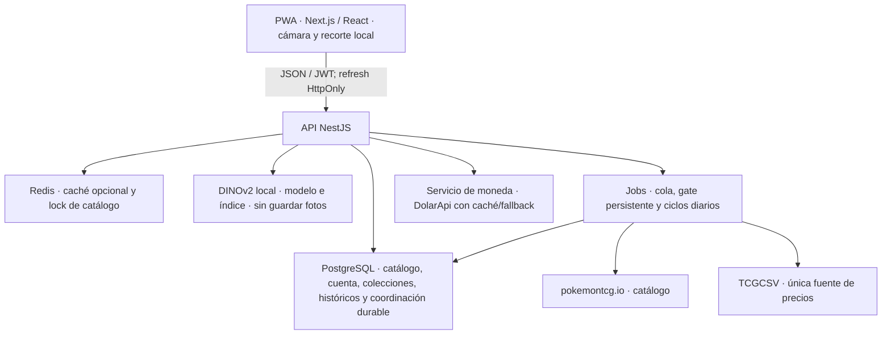

# Arquitectura

> Qué hace el sistema, cómo se arma y por qué está partido como está.

## Vista general



Los handlers públicos de cartas consultan datos locales; encolan lo necesario
sin llamar directamente a los proveedores de catálogo/precios. La cuota de
pokemontcg.io corresponde al sync de catálogo, no al proveedor de precios.


## El flujo de datos, paso a paso

### 1. Reconocer una carta

Teléfono: cámara → sondeo local del encuadre → recorte estable. Escritorio: foto subida → detección y orientación del contorno.

Ambos envían el recorte a `POST /api/cards/identify-visual` autenticado. DINOv2 compara por similitud coseno con el índice local y devuelve los ocho candidatos. No usa ORB ni OCR. El cliente propone el #1, pide su precio y lo suma a la sesión para revisión; no confirma identidad ni edición por sí solo. “Organizar” guarda en la colección elegida mediante los endpoints existentes.

La API procesa la foto sin almacenarla. Reconocer necesita conexión, modelo e índice locales. Las actualizaciones del índice se detectan sin reiniciar el servidor. Ver [escáner](../frontend/docs/scanner.md).

### 2. Consultar el precio de una carta

```
Usuario abre /carta/[id]
   │
   ├─ SSR: carta y set desde el catálogo local (cache de Next: 1 h)
   │
   ├─ HTML de la ficha se entrega sin esperar el precio
   │
   └─ el cliente pide /cards/:id/prices y el backend decide:
      PostgreSQL (lote TCGCSV confirmado) → solicitud local a cola por grupo
      el hero muestra su skeleton mientras tanto
```

La lectura TCGCSV evita la antigua caché por carta para reflejar inmediatamente
un lote confirmado. La fuente se descarga únicamente desde su consumidor serial;
la visita no espera una nueva importación ni llama al proveedor.

### 3. Ciclos e históricos de precios

`price_sync_sets` define el alcance diario (semilla curada y sets usados en
colecciones). TCGCSV planifica a las 21:00 UTC y reanuda cada 15 min mientras la
API y `ENABLE_TCGCSV_INGESTION` estén activos. La consulta interactiva sólo
solicita grupos locales; no pagina el catálogo.

TCGCSV descubre identidades, comprueba `last-updated.txt`/build y reserva cada
archivo de precios durante 24 h. La publicación es atómica y sólo asocia
productos con identidad segura. No hay topes globales de 40 sets/500 requests;
sí ejecución serial, deduplicación y pausas 429/Retry-After.

Las gráficas conservan huecos, cobertura y cambios de composición; no reconstruyen
días que nunca se recibieron. El portafolio usa snapshots atribuidos a TCGCSV y no
los une con historia anterior sin proveedor. TCGdex, su mapper, worker y ciclo
no se registran en la aplicación. Se conservan las observaciones previas como
historia, fuera de precios/totales activos. Ver [historial](../frontend/docs/comparison.md)
y [jobs](../backend/docs/jobs.md).

### 4. Compartir

```
Colección → POST /share → slug aleatorio de 10 chars
                    ↓
            GET /s/:slug  (público, sin sesión)
                    ↓
      items + stats, cacheados 5 min en Redis
      viewCount incrementado fire-and-forget
      NUNCA expone email, username ni id del usuario
```

## La estructura del frontend

El `app/` tiene **cuatro ramas y un layout raíz**, y la razón de que sean carpetas
hermanas y no route groups anidados está en
[`frontend/docs/gotchas.md`](../frontend/docs/gotchas.md) §17.

```
app/
  layout.tsx      raíz: <html>, metadata, script anti-flash, skip link, <Providers>
  providers.tsx   ThemeProvider · AuthProvider · CurrencyProvider · ToastProvider
  (marketing)/    <MarketingShell> — SIN BottomNav: / · /faq
  (app)/          <AppShell> — CON BottomNav: /inicio · /buscar · /carta/[id] ·
                  /escanear · /colecciones* · /ajustes
  (auth)/         <PlainShell> — SIN nav: /login · /registro
  share/          <PlainShell> — SIN nav: /share/[slug]
```

Reglas que explican el resto del árbol:

- **Los providers están arriba, en el layout raíz.** Son de la app entera, no de un
  tipo de pantalla. Montarlos por rama los duplicaría y el estado de la moneda y
  del tema se perdería al navegar.
- **La landing pública y la app instalada son rutas distintas.** `/` explica y
  promociona el producto; `/inicio` es el `start_url` de la PWA y monta el shell.
- **La `BottomNav` es navegación de *tu* cuenta.** Por eso no aparece en la vista
  pública de una colección compartida ni en el login: mandar a alguien a buscar,
  escanear, colecciones y ajustes arriba de la colección de otra persona es un
  invito a dejar de mirarla.
- **La sesión de cuenta se resuelve en cliente.** El access token vive en memoria
  y el refresh en cookie HttpOnly; los guards esperan el bootstrap de sesión.
  Una ruta renderizada no autoriza datos: la API comprueba autenticación y
  ownership. Ver [sesión](../frontend/docs/api-client.md).

El detalle completo está en [`frontend/docs/routes.md`](../frontend/docs/routes.md).

## Por qué dos proyectos y no un monorepo

Decisión consciente, no accidentada. El contexto: el proyecto empezó con la
necesidad de que **dos agentes trabajen en paralelo sin pisarse**, y cada
agente contexto su propio proyecto.

| A favor | En contra (y por qué se ignoró) |
|---|---|
| Un agente lee el backend y **jamás** ve JSX | Tipos compartidos obliga a sincronizar a mano |
| Los agentes no se pisan en `package.json` | Tipos duplicados (`types/api.ts` ↔ DTOs) |
| Un `pnpm run dev` en la raíz los levanta igual | No hay type-checking cruzado |
| Deploy de cada uno por separado | `pnpm install` se corre 3 veces |

El costo asumido es la duplicación de los tipos del contrato. Se mitiga con una
regla estricta: **si tocás un DTO, actualizá el otro lado en el mismo commit**.

## Decisiones de seguridad

| Decisión | Por qué |
|---|---|
| Ownership en el `where`, no como check previo | `findFirst({ where: { id, userId } })` da 404 en vez de 403. Un 403 confirma que el recurso existe. |
| Refresh tokens **opacos** (`randomBytes(48)`), no JWT | Se pueden revocar en BD. Un JWT no se puede revocar sin lista negra. |
| Detección de reuso de refresh token | Si un token ya rotado se vuelve a usar, se revocan **todas** las sesiones del usuario: señal clásica de robo. |
| Contraseñas con argon2id | Incluido en el runtime de Node, sin dependencia nativa extra. |
| El endpoint público nunca toca la API externa | Si lo hiciera, un visitante anónimo podría agotar el rate limit en minutos. |
| `totalValueArs` siempre `null` en el server | El cliente convierte con el rate cacheado: agrega cero latencia a las listas. |

## Puntos donde el sistema es frágil

Documentados en detalle en `docs/data-sources.md` y los `gotchas.md` de cada
proyecto. El resumen para el que arrive nuevo:

1. **pokemontcg.io se deprecó.** Las keys nuevas ya no se dan; las existentes
   mueren el 1 de marzo de 2027. La capa `CardDataProvider` existe para poder
   cambiar a Scrydex sin reescribir.
2. **El rate limit manda sobre el diseño.** Nada puede llamar a la API externa
   desde un handler público. Si agregás una funcionalidad que necesite precios
   frescos, tiene que pasar por el servicio de precios.
3. **Los precios pueden demorar o faltar.** Cola, estado del proveedor, variante
   y cobertura condicionan la respuesta; la UI distingue carga, último conocido
   y ausencia. No hay garantía de una cotización en dos segundos.
4. **El ranking visual puede fallar con reimpresiones y reflejos.** La primera predicción se suma automáticamente; revisá la edición al organizar y usá búsqueda manual si hace falta.
