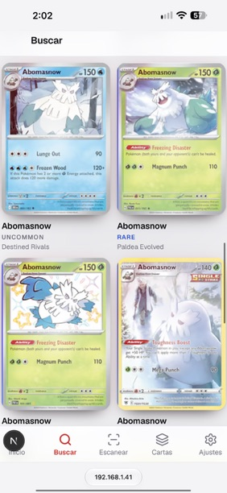
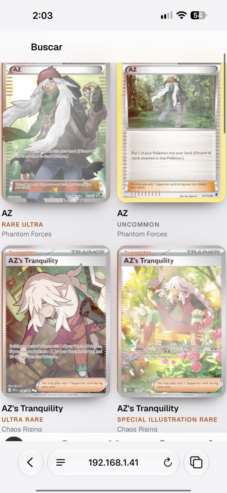
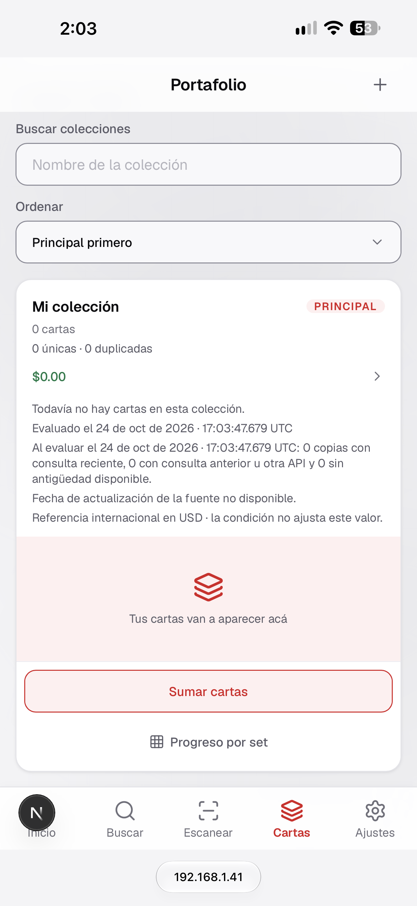
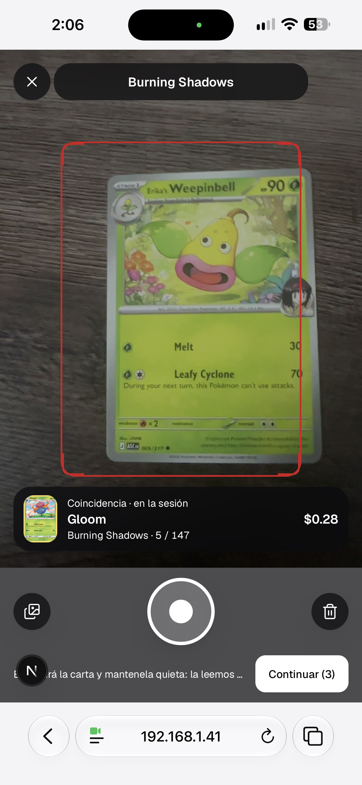
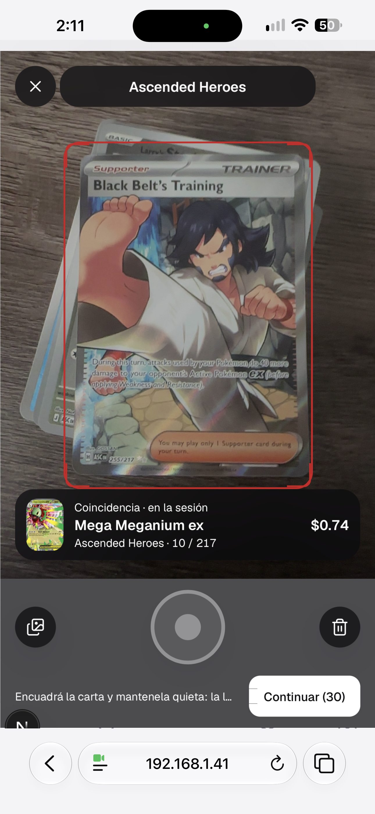
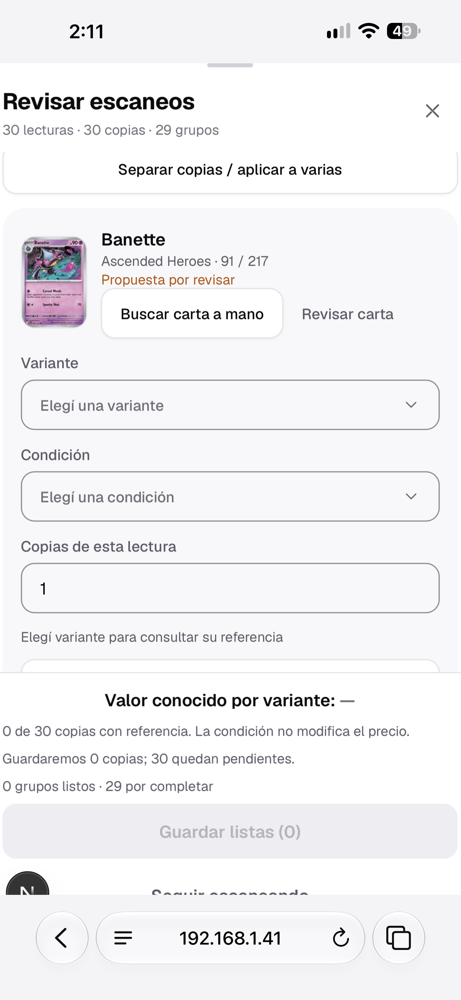
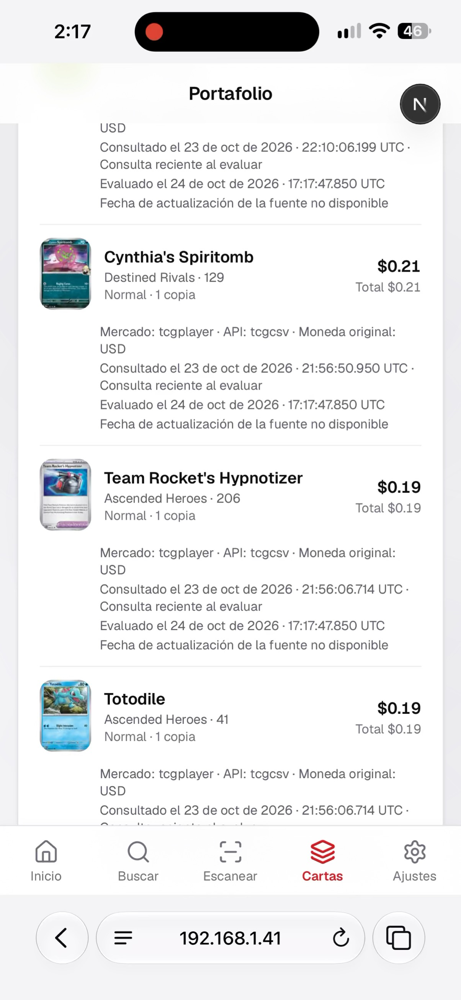

# Revisión del usuario — 25/10/2026

Recopilación cerrada: **7 casos y 7 imágenes recibidas**. El video mencionado
en E07 no fue adjuntado; se recibió una imagen.

Este registro conserva observaciones y comportamientos pedidos por el usuario.
Los fallos relatados no fueron reproducidos por el agente. No se implementaron
cambios de producto durante la recopilación. Por la instrucción posterior «no analices nada aún», el
análisis quedó separado de esta evidencia. El pedido posterior habilitó prepararlo
en el [plan de tareas](TAREAS.md), sin implementar cambios de producto.
El 26/10 el usuario autorizó implementar el plan con GPT-6 Luna. El estado de
ejecución y los reportes se mantienen en ese índice; estas observaciones originales
se conservan como evidencia, no como certificación de una corrección.
Antes de esa instrucción se habían delegado dos consultas sobre E01; sus
resultados no se incorporan a este registro de evidencia del usuario.

Las imágenes se copiaron al directorio `evidencias/` para conservarlas junto al
documento, sin depender de la biblioteca de Fotos del equipo.

## E01 — Quitar el ícono N

- **Pantalla:** Buscar, en Safari del celular.
- **Observación:** el ícono N de la esquina inferior izquierda molesta y se
  superpone al sector de Inicio en la navegación.
- **Pedido:** sacarlo. El usuario desconoce si pertenece a Node o Nest.
- **Estado:** registrado; pendiente de análisis e implementación.

## E02 — Menú inferior oculto por Safari

- **Pantalla:** Buscar, en Safari del celular.
- **Observación:** algunas veces, al subir o bajar por los resultados, el menú
  inferior queda oculto debajo de la barra del navegador.
- **Comportamiento esperado:** poder ver y usar el menú al desplazarse.
- **Estado:** registrado; pendiente de reproducción y análisis.

## E03 — Demasiado texto en la colección

- **Pantalla:** Portafolio, tarjeta de colección vacía.
- **Observación:** el usuario considera innecesaria y poco útil la cantidad de
  información mostrada sobre evaluación, fechas, consultas y fuente de precios.
- **Pedido:** reducir ese texto. No se definió todavía el contenido final.
- **Estado:** registrado; pendiente de análisis y definición.

## E04 — Simplificar el escáner y capturar automáticamente

- **Pantalla:** cámara del escáner.
- **Observación:** tener que tocar Tomar foto por cada carta resulta cansador.
- **Pedidos:**
  - Reproducir un sonido de monedas al mostrar el precio de la carta reconocida.
  - Quitar los botones ubicados a izquierda y derecha de Tomar foto.
  - Quitar la leyenda que aparece debajo, junto a Continuar.
  - Ubicar Continuar a la misma altura que Tomar foto.
  - Tomar la foto automáticamente cuando la carta esté encuadrada en el
    rectángulo, evitando una pulsación manual por cada carta.
- **Estado:** registrado; pendiente de análisis e implementación.

## E05 — Quitar el máximo de 30 cartas

- **Pantalla:** sesión del escáner, con Continuar (30).
- **Observación:** la sesión llega a un máximo de 30 cartas.
- **Pedido vigente:** permitir escanear sin ese límite; por ahora, experiencia
  completa sin límite de cantidad por sesión.
- **Decisión futura:** una versión FREE podría tener límites, pero no se
  definieron valores ni se pide implementar planes en esta revisión.
- **Estado:** registrado; pendiente de análisis e implementación.

## E06 — No pedir variante, condición ni copias

- **Pantalla:** Revisar escaneos.
- **Observación:** completar o modificar esos campos hace perder tiempo.
- **Pedidos:**
  - Usar la variante devuelta por el catálogo junto con el precio, sin pedirla.
  - Asumir siempre condición como nueva, sin solicitarla al usuario.
  - No evaluar condiciones para modificar precios.
  - No pedir la cantidad de copias: sumar automáticamente una copia por cada
    escaneo de la misma carta; dos o más escaneos deben acumularse.
- **Estado:** registrado; pendiente de análisis e implementación.

## E07 — El zoom bloquea el desplazamiento

- **Pantalla:** Portafolio, listado de cartas en Safari del celular.
- **Observación relatada:** al alejar el zoom al máximo, se bloquea el
  desplazamiento vertical. El usuario debe acercar un poco el zoom para volver
  a subir y bajar por la página.
- **Comportamiento esperado:** desplazarse sin tener que ajustar el zoom.
- **Material recibido:** imagen fija. El usuario mencionó un video que muestra
  el comportamiento; ese video queda pendiente de adjuntar. La imagen por sí
  sola no acredita la secuencia ni el bloqueo.
- **Estado:** registrado; pendiente de video, reproducción y análisis.

