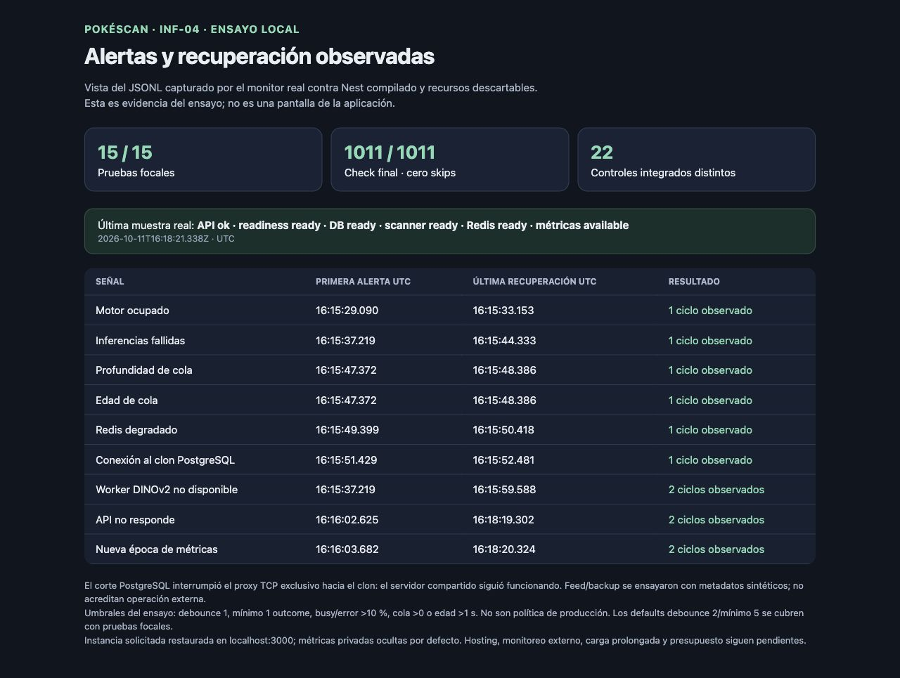

# INF-04 — monitoreo y alertas locales

11/10/2026 · Root acepta la fase local funcional. **INF-04 permanece parcial:** uptime externo, carga prolongada/latencia/consumo total en host objetivo y presupuesto/operador requieren las decisiones de entorno ya registradas. El total del plan se conserva en **19/38 completos y 19 pendientes**, 15 locales y 4 documentales. [Aceptación root](INF-04-aceptacion-root.json).

El monitor consulta health, readiness y las métricas privadas de BE-06. Emite JSONL con señales fijas y transiciones locales, con acciones manuales para cada código. La URL se limita a loopback, el secreto va por entorno y sólo al header de métricas; redirects, timeout, cuerpos mayores a 256 KiB y metadatos mayores a 8 KiB están controlados. Las señales desconocidas conservan alertas activas y cortan rachas de debounce. No recupera ocupado/error por falta de nuevos outcomes. Contadores y medias ponderadas distinguen acumulados, deltas y épocas; un hueco de observación se etiqueta. RSS/CPU corresponden exclusivamente al PID elegido; `%CPU` de macOS es promedio desde inicio, no consumo instantáneo ni total API+worker.

Implementación y configuración en [runbook](../../../infra/inf04-monitor.md), [CLI](../../../../scripts/inf04-monitor.mjs) y [procesamiento](../../../../scripts/inf04-monitor-common.mjs). `pnpm run ops:monitor:test` quedó incluido en el `test` estándar de raíz. No cambia backend/frontend, dependencias, DTOs ni esquema.

## Validación y correcciones

- **15/15 casos focales**, [log final](INF-04-evidencia/final-focal-tests.log): HTTP/redirect/cuerpo/timeout/cancelación, CLI/once/samples/token/argumentos, schemas, fechas, épocas/rollback/histogramas, cola, estados desconocidos/debounce y metadatos. [13 focales anteriores](INF-04-evidencia/focal-tests.log) conservados; los casos no se suman por repetición.
- Root reprodujo **dos fallos reales**: `initializing` cerraba la alerta de worker; `Date.parse` aceptaba texto privado en comentarios y fechas de calendario inválidas. [Regresiones antes: 0/2](INF-04-evidencia/regression-before.log); después 15/15. El cierre del worker requiere `ready` o desactivación explícita válida; las fechas exportadas son UTC ISO con calendario validado.
- [Primer check](INF-04-evidencia/initial-current-check.log):1009/1009, sin skips, anterior a esas correcciones. [Check final estándar exacto](INF-04-evidencia/current-check.log) después de `pnpm run stop`, en clon estándar fresco y Redis propios: **1011/1011, cero skips**, lint/tipos y builds Nest/Next Turbopack. Desglose:428 backend+13 scripts backend+6 e2e+549 frontend+15 monitor. [Recibo de comandos](INF-04-evidencia/current-check-result.json). No cambia timeout/specs históricos ni repite diagnóstico socket/backfill.
- **22 controles integrados distintos**, [21 en ensayo principal](INF-04-evidencia/runtime-result.json) y [1 observación terminal focal del reinicio](INF-04-evidencia/restart-final-result.json). API Nest compilada, CLI real, DINOv2 real, cuenta sintética sólo en clon y recorte sintético en memoria. Dos ráfagas produjeron 2 éxitos y 8 rechazos503; tasas busy e inferencia fallida tienen denominadores distintos y no describen una cohorte exacta.

| Caso | Evidencia y límite |
|---|---|
| Ocupado/error | Alertas y recuperaciones con nuevos outcomes reales. Recorte inválido causa400 e inferencia fallida; no equivale a HTTP500. Recuperación espera readiness y luego nuevas inferencias200. Sin precisión de carta física acreditada. |
| Cola | Fixtures pending/processing en clon; profundidad conjunta, edad máxima y recuperación con cola vacía. IDs no salen por JSONL. |
| Redis | Stop/start exclusivamente del contenedor propio, verificado por ID completo/label; alerta y recuperación, API viva y readiness200. |
| PostgreSQL | Se corta/reabre el proxy TCP propio hacia el clon; health200 y readiness503 durante el corte, consulta de cola no disponible. Es interrupción de conectividad, no caída del servidor PostgreSQL compartido. |
| Worker | Se verifica pertenencia del hijo DINOv2 al API QA antes de terminarlo. Alerta y warmup en background hasta `ready`, sin recuperarse falsamente en `initializing`. |
| Reinicio API | Monitor observa API inaccesible→recuperada, nueva época y deltas no negativos. Observación terminal focal espera `ready` y cierre de todas las alertas de disponibilidad que realmente se dispararon antes de teardown. |
| Feed/backup | Sólo metadatos sintéticos `ok/failed`. No acredita proveedor, antigüedad operativa, backup recuperable ni destino externo. Sin entrada verificada informa `unknown`. |
| Privacidad | JSONL excluye secreto, JWT/contraseña, usuario, recorte, IDs de cartas/jobs y campos arbitrarios. No debugoutbox, SMTP, grabación ni fotos persistidas. |

[JSONL principal](INF-04-evidencia/monitor-runtime.jsonl), [JSONL de reinicio focal](INF-04-evidencia/restart-final.jsonl), [corroboración root](INF-04-evidencia/runtime-root-verification.json) y [configuración del ensayo](INF-04-evidencia/runtime-config.json). Umbrales locales explícitos:intervalo1s, timeout3s, debounce1/mínimo1, busy/error>10%, profundidad>0, edad>1s; se usan para producir señales observables en un ensayo breve y no son política de producción. Los defaults debounce2/mínimo5 se cubren focalmente. Cada código tiene diagnóstico/acción en el runbook; no se ejecuta recuperación automática desde el monitor.

El primer [harness](INF-04-evidencia/initial-runtime-console.log) detuvo el ensayo al enviar inferencias de recuperación mientras el worker estaba indisponible; [muestras](INF-04-evidencia/initial-monitor-runtime.jsonl) explican ausencia de nuevos éxitos. La siguiente [corrida privada](INF-04-evidencia/second-runtime-console.log) detuvo por una expectativa de HTTP500/503 errónea: el contrato retorna400. Se corrigieron espera y expectativa con evidencia, sin nueva modificación de producto ni repetición del check verde. El principal comprobó API ready mediante probe pero terminó antes de la siguiente muestra del monitor; la continuación focal acreditó ese último estado. Se preservan todos los resultados y no se cuenta como distintas la repetición de los mismos casos.

## Integridad, cleanup e instancia disponible

[Baseline de 532 fuentes](INF-04-evidencia/source-before.json):531 intactas; única fuente existente modificada `package.json`, para comandos e integración del test; se añadieron tres scripts y runbook. [Recibo de alcance](INF-04-evidencia/source-integrity.json). El primer baseline runtime conserva1427/1429 intactos y dos deltas root autorizados después del ensayo, sin afirmar que era la versión final; [recibo](INF-04-evidencia/initial-runtime-integrity.json). **1429 fuentes/outputs finales intactos** durante los ensayos finales y hasta restauración, [recibo](INF-04-evidencia/runtime-integrity.json).

Los tres clones/Redis propios fueron retirados: [primer cleanup](INF-04-evidencia/initial-cleanup-receipt.json), [principal](INF-04-evidencia/full-runtime-cleanup-receipt.json) y [continuación](INF-04-evidencia/cleanup-receipt.json). Ownership, markers, IDs completos y SQL0 antes del drop. Se corroboran conteos acotados de dev/TEST y GIN, IDs de contenedores compartidos y Redis saludable; no se afirma identidad byte a byte de toda la DB. Dev mantiene13 migraciones,22 usuarios/22 colecciones/69 ítems/13 shares/20670 cartas/GIN5; TEST11 migraciones y7 cotizadas. Proveedores/jobs/crons bloqueados en runtime. [Procesos propios terminados](INF-04-evidencia/restart-final-owner.json) y [servidor/pestaña de captura retirados](INF-04-evidencia/visual-cleanup.json).

**Instancia solicitada intencionalmente viva [localhost:3000](http://localhost:3000)**: API compilada y Next standalone sobre dev habitual; [recibo final](INF-04-evidencia/final-instance.json). Login200, health200, ready200; ops404por defecto sin configurar secreto. APIlistener56735/pnpm56724/launcher56706; Nextlistener56740/pnpm56737. No nuevas fixtures en dev ni QA viva. No reset/stash/commit/deploy/upgrades/contacto externo. Automatización PAUSED/dos horas conservada, sin modificarla. Dos encargos Luna, correcciones/revisión/gates root; contadores persisten, sin subdelegación.

La captura es una vista estática del JSONL de los ensayos, no un dashboard de producto ni uptime externo. [HTML de evidencia](INF-04-evidencia/monitor-evidencia.html). No cambia IDs por imágenes.

El siguiente paso propuesto es **INF-01: resolver la elección de entorno de hosting**, para poder avanzar a monitoreo externo y presupuesto con datos reales. Las entradas humanas ya registradas siguen pendientes. Esperar respuesta del usuario: no se reservó ni inició ese paso.
