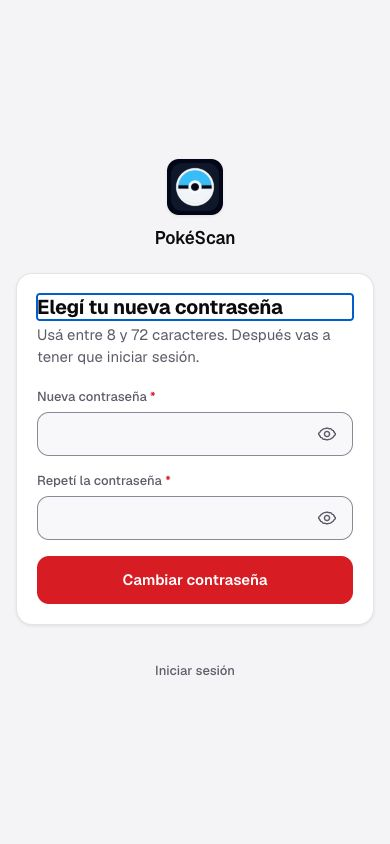
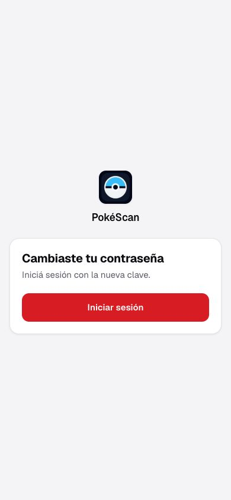

# Resend — adaptador y ensayo local aceptados

Fecha: 11/10/2026. Usuario autorizó implementar y **simular**, porque todavía no tiene cuenta; cuenta, dominio y envíos externos quedan para el final. Dictamen root: **implementado y verificado localmente**. [Aceptación](RESEND-simulado-aceptacion-root.json). No cierra la operación externa de INF-01 ni la eliminación pendiente de BE-05; **19/38 completos,19 pendientes**.

## Resultado funcional

El binding de auth usa una factory del adaptador Resend, **deshabilitado por defecto**. Sólo configuración completa y modo explícito pueden habilitarlo posteriormente. Fetch nativo, endpoint Resend fijo, sin URL de proveedor por entorno ni redirecciones/retries. Mensaje de texto plano con el token en el fragmento de `/recuperar`; destinatario/remitente/asunto/texto, sin IDs de usuario ni tags. Sin bandeja pública de depuración, almacenamiento de correo ni credenciales nuevas. [Guía](../../../infra/resend-recovery.md).

Se ensayó el adaptador compilado mediante transporte DI privado que redirige únicamente la URL fija a un servidor HTTP real en loopback. Nest/API, Next y PostgreSQL/Redis reales locales; fixture sintética propia, payload/credenciales sólo en memoria del harness y contexto temporal de navegador. Ningún request a Resend ni SMTP. El enlace generado declara un origen HTTPS sintético; el navegador prueba su fragmento sobre la ruta local HTTP compilada. Esto acredita el consumidor local, no DNS/HTTPS público.

El recorrido recibió 202 genérico/no-store, verificó payload y hash PG, capturó/removió fragmento en Next, cambió contraseña desde UI real, rechazó replay y clave anterior, aceptó clave nueva y rechazó refresh anterior. Simulador probó 429/500, redirect, JSON inválido, cuerpo excesivo, respuesta perdida y demora: un solo handoff por caso, sin replay ni invalidación de enlaces por incertidumbre; el token de la respuesta perdida fue consumible. Conexiones cerradas y servicio drenado.

## Verificación y correcciones

- **11 pruebas focales**: configuración/factory, orden de autorización/lectura, campos y fragmento, destinatario/token/generación, expiry durante autorización/getter, abort por fases, HTTP/retries, JSON/tamaño y deadline. [Log](RESEND-simulado-evidencia/current-focused.log).
- **Check estándar final 1022/1022,0 skips**:439 Vitest backend +13 scripts backend +6 e2e +549 frontend +15 monitor; lint, tipos y builds Nest/Next Turbopack verdes. Stop previo; clon marcado y Redis propios. [Resultado](RESEND-simulado-evidencia/current-check-result.json), [log](RESEND-simulado-evidencia/current-check.log).
- **38 controles funcionales y 9 de aislamiento/ownership**,47 total, todos aprobados. [Controles](RESEND-simulado-evidencia/runtime-checks.json), [resumen](RESEND-simulado-evidencia/summary.json), [harness conservado para auditoría](RESEND-simulado-evidencia/runtime-harness-audit.mjs). El harness no es un comando portable: requiere preparación privada de ownership y dependencias locales.
- **1333 fuentes/outputs seleccionados intactos durante el consumidor**. [Verificación](RESEND-simulado-evidencia/runtime-source-output-verification.json). Excluye cachés y el árbol completo de dependencias.

Luna realizó dos encargos (implementación y corrección estática), sin subdelegación. Root pidió reloj monotónico, nueva comprobación de vigencia antes de leer el secreto y sincronización explícita de abort en specs; revisó/corrigió guía y validó serialmente. El primer check pasó tests pero falló Nest build con **TS2571** por repetir casts de una propiedad unknown. Root vinculó `id` a una variable local para narrowing y comprobó string no vacío/acotado. Focal y check final tras ese delta pasaron. [Fallo inicial conservado](RESEND-simulado-evidencia/initial-current-check.log), [resultado inicial](RESEND-simulado-evidencia/initial-current-check-result.json). No se atribuyen fixes a diagnósticos históricos ni se repiten sus ensayos.

## Capturas reales seguras

Enlace recibido en simulador, formulario vacío y fragmento ya removido:

Cambio confirmado por API/PostgreSQL y UI:

Root inspeccionó ambas: sin token, email, contraseña, fotos de consulta ni datos personales. No traces/videos.

## Cleanup, instancia y límites

Clon `resend_9a1bd1933128_test` y Redis own retirados verificando marker/full IDs y SQL0. Servidor simulado, Next de QA y navegador cerrados. [Cleanup runtime](RESEND-simulado-evidencia/runtime-resource-cleanup.json), [cleanup infra/conteos](RESEND-simulado-evidencia/cleanup-receipt.json): dev13migraciones,22usuarios/22colecciones/69items/13shares,20.670cartas y5GIN; TEST11migraciones,2usuarios/3colecciones/2items/1share,20.670cartas y7cotizadas estándar/5GIN; Redis compartido sano. Son conteos/identidades acotados, no comparación byte a byte de bases compartidas. [Ownership](RESEND-simulado-evidencia/db-owner.json) ya sin recursos propios vivos.

Al inicio no había listeners3000/3001; no se supuso vigencia de PIDs anteriores. La instancia solicitada quedó restablecida intencionalmente viva en localhost:3000: API64068/pnpm64057/launcher64056 y Next64082/pnpm64071/launcher64070, comprobados por ascendencia. [Recibo actual](RESEND-simulado-evidencia/final-instance.json):login/health/ready200,metrics404por defecto y recuperación503porque correo real sigue apagado; jobs/crons/proveedores bloqueados. Sesiones de ejecución94439(API) y22018(Next) intencionalmente abiertas. Verificar recibo/procesos antes de detener en tareas futuras.

Quedan para el final: cuenta, dominio/remitente/DNS, secreto privado, tracking desactivado en proveedor y envío externo controlado, con autorización aplicable. No acredita recepción en buzón, reputación, HTTPS público, operación externa ni política de retención/eliminación. No upgrades, commit/deploy, migraciones dev, reset/stash ni datos reales de fixtures. La configuración productiva es preparación de código; **no está activada**. Automatización PAUSED/dos horas conservada. Próximo paso propuesto: decidir canal para eliminación de cuenta; preguntar antes de iniciar.
